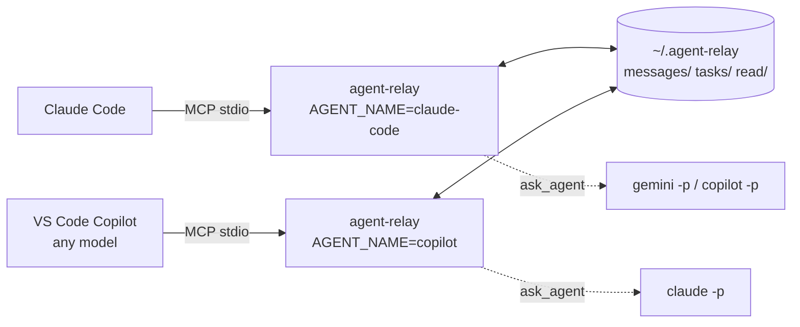
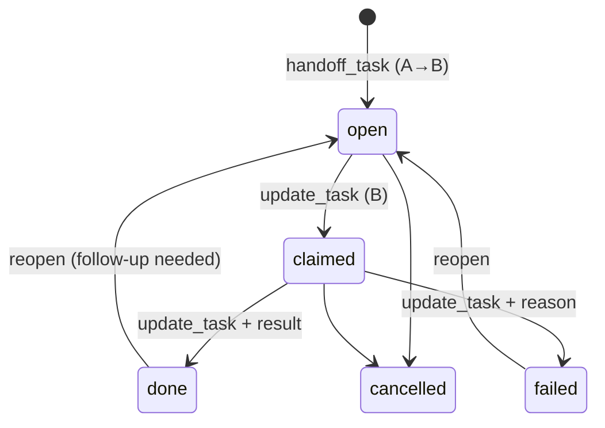
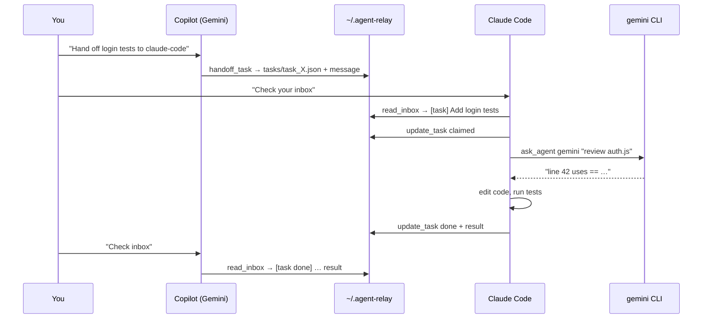

# How agent-relay works

## The problem

AI coding agents are isolated from each other:

- **Claude Code** runs Claude models in your terminal. It can't use the models
  available in GitHub Copilot (Gemini, GPT, …).
- **GitHub Copilot in VS Code** can run many models, but it can't call Claude Code
  or hand Claude Code work to do.
- Neither one knows the other exists, so they can't coordinate, and they can edit the same
  files at the same time.

## The idea

Both tools support **MCP (Model Context Protocol)**. MCP is a standard way to give an
AI agent extra *tools*. An MCP server is a small program the agent launches and
talks to over stdin/stdout using JSON-RPC.

agent-relay is one MCP server that **every agent loads**. Each agent runs its own copy,
but all copies read and write **the same folder** (`~/.agent-relay`). That folder
acts as a shared mailbox and task board:



There's no daemon, network port, or database. Two processes writing files is
enough, because each message is its own file (see *Concurrency* below).

## The three ways to communicate

### 1. Messages (asynchronous)

`send_message(to, body, subject?, thread_id?)` writes one JSON file. The
recipient sees it the next time it calls `read_inbox`, which also marks it as read for
that agent. Replies that pass `thread_id` are grouped into a thread.
`to: "*"` broadcasts to everyone.

### 2. Task handoff (asynchronous, with a lifecycle)



Every status change automatically sends a message to the other side, so the
creator sees `[task done] …` with the result in its inbox. Claiming a task
prevents two agents from doing the same work.

### 3. Direct ask (synchronous)

`ask_agent(agent, prompt)` runs another agent's **CLI in headless mode** and
returns its stdout as the tool result:

| agent key | command (from `agents.json`) |
|---|---|
| `claude-code` | `claude -p "<prompt>" --output-format text` |
| `gemini` | `gemini -m gemini-2.5-pro -p "<prompt>"` |
| `copilot` | `copilot -p "<prompt>"` |

This is how Claude Code gets to use Gemini, and how Copilot gets to use Claude.
The prompt is passed as a single argument with no shell, so the prompt's text can't run
commands. The question and the answer are also saved on the relay as a thread, for an audit
trail.

> Copilot *inside VS Code* has no headless entry point. `ask_agent copilot` uses the
> standalone `copilot` CLI (same account and models). To reach the Copilot chat
> in VS Code, use messages and tasks.

## A full round trip



Run it yourself: `npm run demo`.

## Storage layout

```
~/.agent-relay/
├── messages/
│   └── msg_<time>_<rand>.json   one file per message
├── tasks/
│   └── task_<time>_<rand>.json  one file per task (rewritten on update)
├── read/
│   └── <agent>.json             ids of messages this agent has read
└── server/                      stable copy of the server (written by the VS Code extension for Claude Code)
```

Message:

```json
{ "id": "msg_…", "threadId": "msg_… | task_…", "from": "copilot", "to": "claude-code",
  "subject": "[task] Add login tests", "body": "…", "taskId": "task_… | null",
  "createdAt": "2026-11-01T13:33:59.867Z" }
```

Task:

```json
{ "id": "task_…", "from": "copilot", "to": "claude-code", "title": "…", "details": "…",
  "status": "open|claimed|done|failed|cancelled", "claimedBy": null, "result": null,
  "createdAt": "…", "updatedAt": "…", "history": [{ "at": "…", "by": "copilot", "status": "open" }] }
```

IDs start with a base-36 millisecond timestamp, so sorting by filename gives chronological order.

## Concurrency

- Each new message is a **new file**, so two agents sending at the same moment
  never overwrite each other.
- Every write goes to a temp file first and then gets renamed into place. Rename is atomic, so readers
  never see half-written JSON. Unreadable files are skipped.
- Task updates rewrite a single file. Simultaneous updates to the *same* task
  are last-write-wins, but the claim step keeps one agent per task in practice.

## Loop safety

Agents replying to agents can loop forever. The relay enforces limits on every sender except
`human`. The table in [`skills/agent-relay-loop-safety`](../skills/agent-relay-loop-safety/SKILL.md) covers them:
thread length, send rate, duplicate messages, task bounce-back, task update
count, and `ask_agent` nesting depth (passed to child processes through
`AGENT_RELAY_DEPTH`). A blocked call returns an error starting with
`LOOP GUARD:` that tells the agent to stop and ask the human.

## How agents learn to use it

1. **Tool descriptions:** each MCP tool explains itself, so models pick it up
   automatically.
2. **Server instructions:** sent during MCP `initialize` ("call read_inbox at
   the start of a task…").
3. **Skills** (`skills/*/SKILL.md`): deeper playbooks that Claude Code and Copilot
   load when relevant. See [SKILLS.md](SKILLS.md).
4. **Project instructions:** `CLAUDE.md` / `.github/copilot-instructions.md`
   snippet (`examples/AGENT_INSTRUCTIONS.md`).

## Components

| Path | What |
|---|---|
| `src/server.js` | MCP server: JSON-RPC over stdio, tool definitions |
| `src/bus.js` | File-backed messages, tasks, read state, loop guards |
| `src/agents.js` | `ask_agent`: runs agent CLIs, depth guard |
| `src/cli.js` | Human CLI (`inbox`, `send`, `tasks`, `watch`, `ask`, `install-skills`) |
| `src/bin.js` | Entry point: no args → MCP server, subcommand → CLI |
| `agents.json` | Which CLIs `ask_agent` can run |
| `skills/` | Agent skills (Claude Code + Copilot) |
| `vscode-extension/` | Registers the server with VS Code automatically, plus inbox UI |

## Limits and non-goals

- **Not real-time push.** An agent only sees new messages when it calls `read_inbox`.
  The VS Code extension shows a badge and notification so *you* can tell the agent.
- **Single machine.** The relay is a local folder. It can be shared over a synced folder,
  but it wasn't designed for that.
- **No auth between agents.** Anything that can write to the folder can post as any
  name. Don't put secrets in messages.
